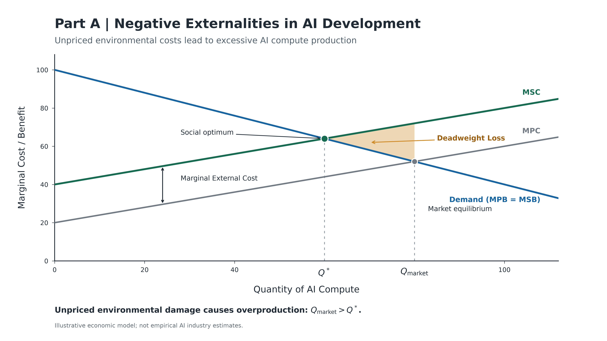
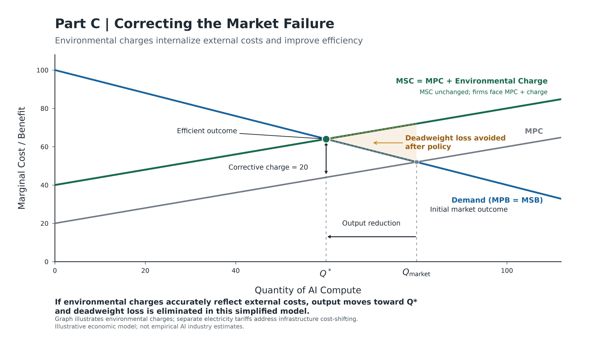

# SS111 Market Failure Graphs

Illustrative diagrams of a negative environmental externality in AI compute and a corrective environmental charge, prepared for an SS111 presentation.

## Graphs

| Market failure | Policy solution |
| --- | --- |
|  |  |

High-resolution PNG and editable SVG versions are in [`output/`](output/).

## Recreate the graphs

Requires Python 3.10 or newer.

```bash
python -m venv .venv
source .venv/bin/activate
pip install -r requirements.txt
python ai_market_failure_graphs.py
```

The model uses illustrative linear demand and cost schedules. Its values are not empirical estimates of the AI industry.
